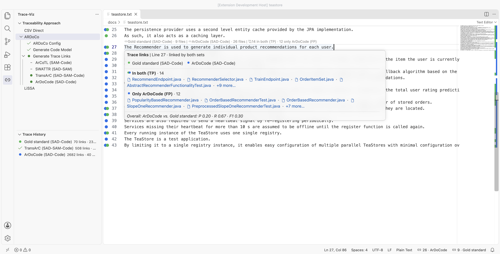
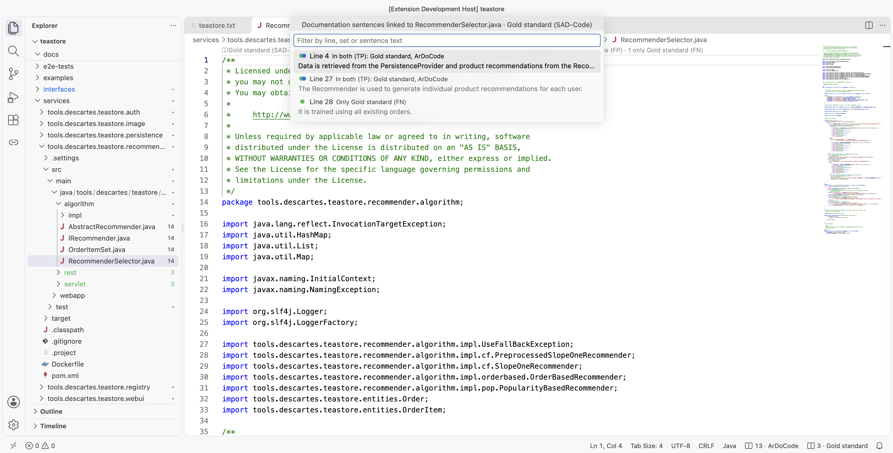

# TraceViz

**TraceViz** is a Visual Studio Code extension that brings software architecture trace links directly into the developer's editing context.
It visualizes links between natural language **Software Architecture Documentation (SAD)** and **source code** as colored gutter markers, enabling one-click navigation from any documentation sentence to the linked code files — and back — without leaving the IDE.



*Colored gutter dots mark SAD-Code trace links of the active sets. A CodeLens above each linked line summarizes both sets, and the hover shows which code files are linked by both sets, which only by one, and the precision, recall and F1 of an approach against a gold standard. The sidebar lists the available TLR approaches and the Trace History.*



*In a linked code file, a CodeLens at the top and badges in the file explorer show how many documentation sentences link to it. The Quick Pick lists these sentences with a colored icon and the sentence text, and marks each one as linked by both sets or only by one.*

---

## Features

- **Named trace link sets** — every set in the Trace History has a readable name and a color; the name is used in the hover, CodeLens, Quick Pick, and status bar
- **Gutter markers** — lines with trace links are annotated with colored dots, one per active set
- **Hover with legend** — hovering a marked line shows a legend of the active sets, the linked files per set, and clickable file names that open the code
- **CodeLens** — a CodeLens above each linked documentation line summarizes the links per set; linked code files get a CodeLens at the top that summarizes the linked documentation sentences
- **Quick Pick navigation** — click a gutter dot, CodeLens, or status bar item to pick a linked file (from documentation) or a linked sentence (from code); entries have colored icons and show the sentence text
- **Side-by-side comparison** — up to two trace link sets can be active at once; links are grouped into "in both", "only A", and "only B"
- **Evaluation against a gold standard** — if one of the two sets is a gold standard (`isGoldStandard` in the history entry, or "gold" in its name), the groups are labeled TP, FP, and FN, and the hover shows precision, recall, and F1
- **Explorer badges and overview ruler** — files with trace links get a colored badge in the file explorer, and linked lines are marked in the overview ruler
- **Unlinked sentences** — the command **TraceViz: Toggle Unlinked Sentences** marks documentation lines without any trace link
- **Directory heuristic** — when all files in a folder link to the same line, a single directory-level dot replaces per-file markers, reducing visual noise
- **Trace History** — past runs are persisted in a history panel with a summary per set (links, sentences, files) and can be re-activated with one click
- **Multiple trace link sources**:
  - **ARDoCo REST API** — ArDoCode (SAD-Code) and TransArC (SAD-SAM-Code) via [rest.ardoco.de](https://rest.ardoco.de)
  - **LiSSA** — generic RAG-based TLR via a local JAR invocation
  - **CSV Direct** — import trace links from any tool producing the expected format

### Try it in the browser

A demo with preloaded trace links runs in the browser at <https://ardoco.de/traceviz/>. It can also run ArDoCode and TransArC via the ARDoCo REST API with a preset MediaStore configuration and code model; code model extraction and LiSSA are available in the desktop extension only.

## Getting Started

### Prerequisites

- Visual Studio Code `^1.100.0`
- (Optional) A [code model extractor JAR](https://github.com/ardoco/code-model-extractor-cli) for generating code models from Java projects

### Running the Extension (Development)

1. **Clone and install dependencies**:
   ```bash
   git clone https://github.com/ardoco/traceviz.git
   cd traceviz
   npm install
   ```

2. **Start the TypeScript compiler in watch mode**:
   ```bash
   npm run watch
   ```

3. **Launch the extension**: press `F5` in VS Code (or **Run → Start Debugging**).
   A new Extension Development Host window opens with TraceViz active.

### Usage

1. **Open a project folder** in VS Code.
2. **Access TraceViz** via the activity bar (chain link icon) — the sidebar shows two panels:
   - **Traceability Approach** — configure and trigger a TLR run
   - **Trace History** — browse and re-activate past results
3. **Choose a trace link source**:
   - **ARDoCo** → configure the REST API endpoint, select a pipeline (ArDoCode or TransArC), and generate trace links
   - **LiSSA** → point to a local LiSSA JAR and run
   - **CSV Direct** → import a CSV file with pre-generated trace links
4. **Navigate** — gutter dots appear on every linked line. Hover for the linked files per set, click a dot or CodeLens to open the Quick Pick navigator.
5. **Compare** — activate a second set in the Trace History to see where the sets agree; if one of them is a gold standard, the hover also shows TP, FP, FN, precision, recall, and F1.

### Configuration

| Setting | Description | Default |
|---|---|---|
| `trace-viz.codeModelExtractorJar` | Path to the [code model extractor JAR](https://github.com/ardoco/code-model-extractor-cli) | *(empty)* |
| `trace-viz.logLevel` | Log verbosity: `DEBUG`, `INFO`, `WARN`, `ERROR` | `INFO` |

## Development

```bash
npm run compile   # one-shot TypeScript build
npm run watch     # continuous rebuild
npm run lint      # ESLint
```

### Project Structure

| Path | Contents |
|---|---|
| [src/commands/](src/commands/) | VS Code command handlers |
| [src/services/](src/services/) | Core services (CSV reader, decoration, path resolver, …) |
| [src/traceabilityApproach/](src/traceabilityApproach/) | Approach implementations: [ardoco/](src/traceabilityApproach/ardoco/), [lissa/](src/traceabilityApproach/lissa/), [csv/](src/traceabilityApproach/csv/) |
| [src/views/](src/views/) | Sidebar view providers |
| [src/visualization/](src/visualization/) | Gutter decoration and line-to-file mapping logic |

## License

See [LICENSE](LICENSE) for details.

## Acknowledgements

TraceViz was initially implemented by Julian Winter as part of his [bachelor's thesis](https://publikationen.bibliothek.kit.edu/1000192928) at KIT.
